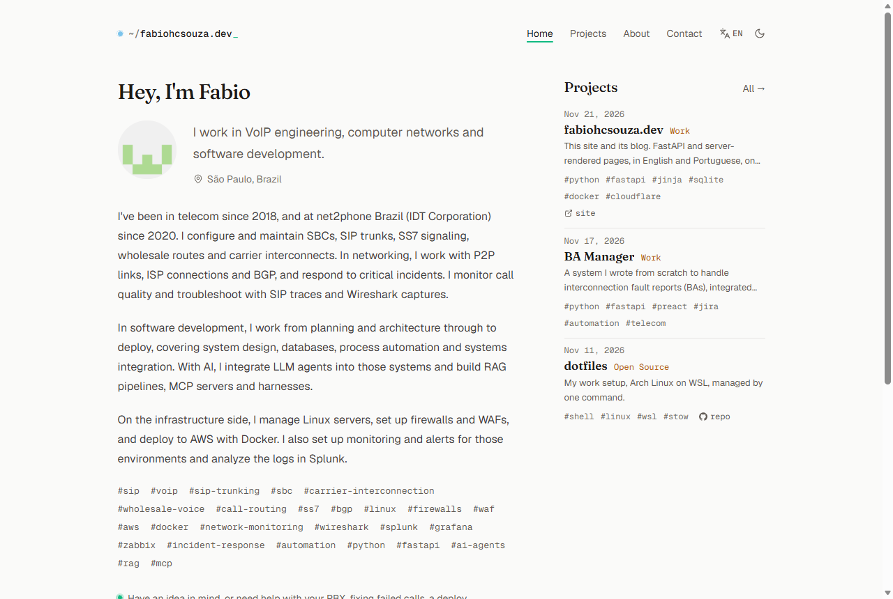
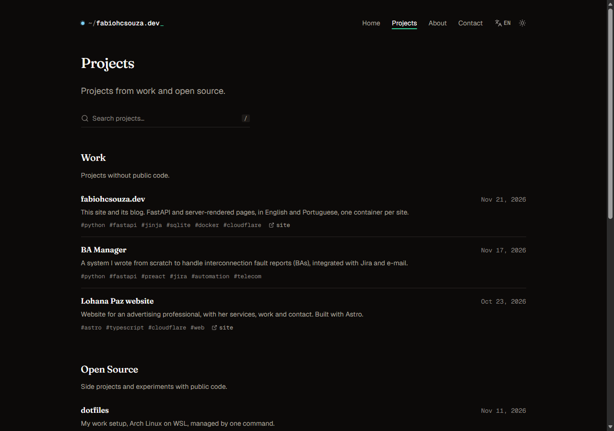
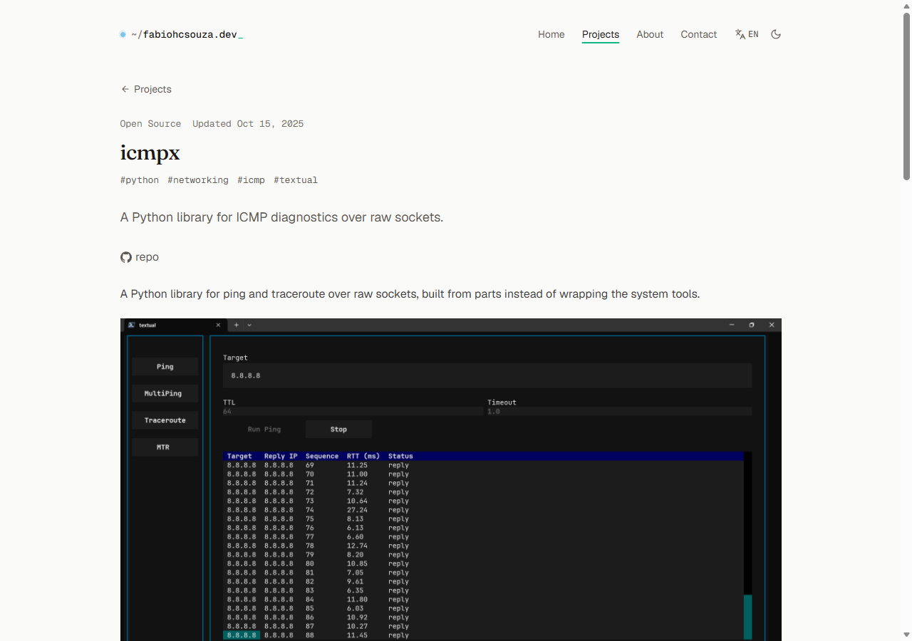
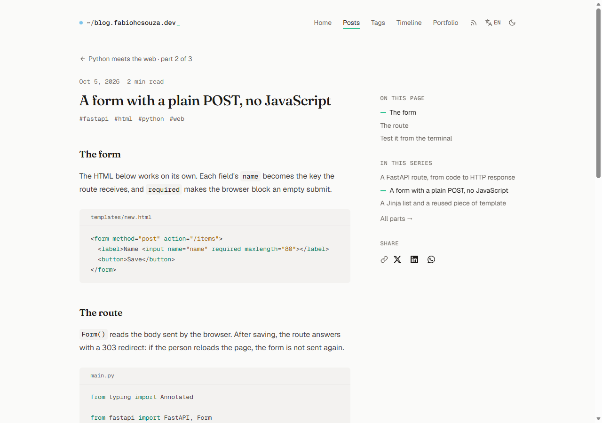
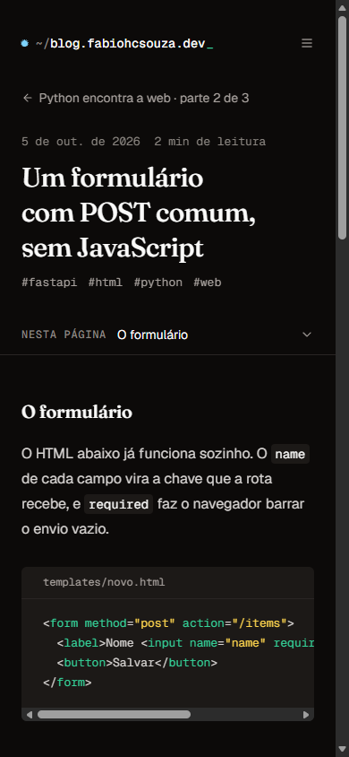

# fabiohcsouza.dev

**English** · [Português](README.pt-BR.md)

My portfolio and blog posts.

| Site | Domain |
| --- | --- |
| Professional portfolio | [fabiohcsouza.dev](https://fabiohcsouza.dev) |
| Blog: writing on VoIP, networks, automation, development and AI | [blog.fabiohcsouza.dev](https://blog.fabiohcsouza.dev) |



<p>
  
  
</p>
<p>
  
  
</p>
<p>
  
</p>

The blog screenshots use the sample posts from `tests/sample/`.

Python 3.14 and FastAPI render every page on the server with Jinja2. Pages, projects and posts are Markdown folders
in `content/`. SQLite keeps the contact messages and the newsletter, and e-mail goes out over SMTP.

## Run it

```bash
uv sync
```

```bash
uv run task dev
```

Open http://portfolio.localhost:8000 and http://blog.localhost:8000 (`*.localhost` points to your machine); Portuguese
is under `/pt/`. To change a setting, put that line in a `.env` (`.env.example` lists them all, with the production values). With Docker:
`docker compose -f docker/compose.dev.yml up --build`.

## Commands

`uv run python -m app <command>`

| Command | What it does |
| --- | --- |
| `serve [--reload]` | run the sites |
| `leads [--last N]`, `stats` | contact messages |
| `subscribers` | newsletter subscribers |
| `send-post <slug> [--send]` | e-mail a published post to the subscribers (a dry run without `--send`) |
| `projects-dates` | set each project's `updated` to the date of its last commit on GitHub |
| `images` | a lighter WebP next to each PNG/JPEG in `content/` |
| `i18n` | collect the interface strings into the Portuguese catalog |
| `purge` | apply the data retention rules now |

## Tasks

`uv run task <task>` (taskipy; `uv run task --list` shows them all)

| Task | What it does |
| --- | --- |
| `dev` | run both sites with reload |
| `check` | everything CI checks: `lint`, `types`, `sec`, `templates`, `test` |
| `lint`, `types`, `sec`, `templates`, `test` | Ruff, ty, Bandit, djLint and pytest, one at a time |
| `audit` | known vulnerabilities in the installed packages |
| `i18n` | collect the interface strings into the Portuguese catalog |

## Layout

```
app/main.py     the app: middleware, one sub-app per site, the daily purge
app/api/        routes (portfolio, blog, contact, newsletter, seo), dependencies, the page registry
app/core/       settings, database, security (middleware, rate limits, Turnstile), i18n
app/models.py   tables and form input        app/crud.py   reads and writes
app/content/    reads content/: pages, projects, posts
app/utils/      Markdown, e-mail, rendering, JSON-LD
app/templates/  Jinja templates; app/locales/ the Portuguese catalog
content/        pages, projects and posts, one folder each, images in its assets/; site.yml
app/static/     CSS, JavaScript, fonts, icons
docker/         Dockerfile, compose.yml (production), compose.dev.yml
.env.example    every setting, with the production values
tests/          pytest, with sample posts in tests/sample/
```

## Documentation

- [Content](docs/content.md): writing pages, projects and posts, with images
- [Deploy](docs/deploy.md): production, one site or both, updates, backups
- [Development](docs/development.md): tests, translations, debugging
- [Architecture](docs/architecture.md): how a request is served and where the code is
- [Rules](docs/business-rules.md): contact, newsletter, data retention, limits
- [Security](docs/security.md) · [Design](docs/design.md)
- [TODO](TODO.md): what may come later (webhook, send queue, observability)
