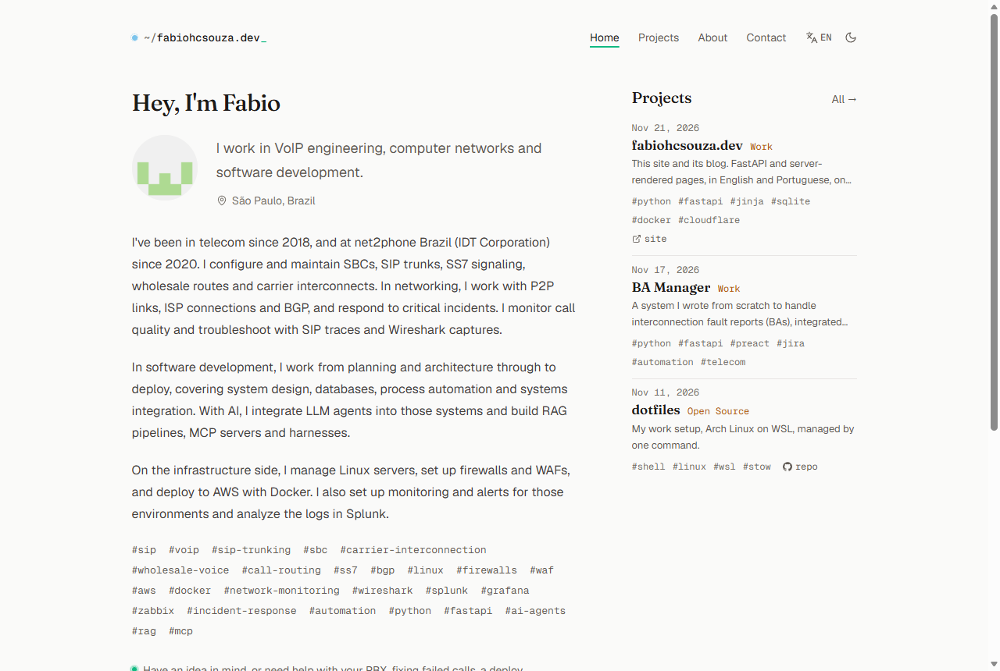
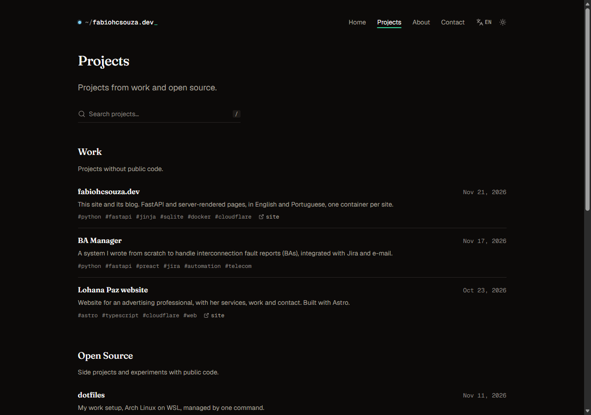
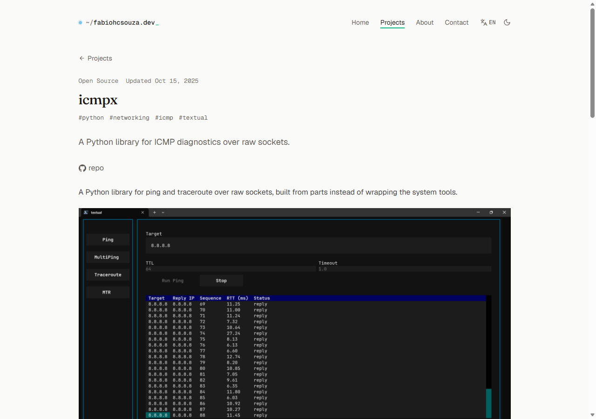

# fabiohcsouza.dev

[English](README.md) · **Português**

Meu portfólio e meu blog, em inglês e português.

| Site | Domínio |
| --- | --- |
| Portfólio: quem eu sou, o que construí, contato | [fabiohcsouza.dev](https://fabiohcsouza.dev) |
| Blog: notas sobre VoIP, redes, automação, código e IA | [blog.fabiohcsouza.dev](https://blog.fabiohcsouza.dev) |



<p>
  
  
</p>

Python 3.14 e FastAPI geram todas as páginas no servidor com Jinja2; o CSS e o JavaScript são arquivos puros, sem
build. Páginas, projetos e posts são pastas de Markdown em `content/`. O SQLite guarda as mensagens de contato e a
newsletter, e os e-mails saem por SMTP. Uma imagem Docker serve qualquer um dos dois sites.

## Rodar

```bash
uv sync
```

```bash
uv run python -m app serve --reload
```

Abra http://portfolio.localhost:8000 e http://blog.localhost:8000 (`*.localhost` aponta para a sua máquina); o
português fica em `/pt/`. Em desenvolvimento as configurações são opcionais: copie o `.env.example` para `.env` para
mudar alguma. Com Docker: `docker compose -f docker/compose.dev.yml up --build`.

## Comandos

`uv run python -m app <comando>`

| Comando | O que faz |
| --- | --- |
| `serve [--reload]` | roda os sites |
| `leads [--last N]`, `stats` | mensagens de contato |
| `subscribers` | assinantes da newsletter |
| `send-post <slug> [--send]` | manda um post publicado para os assinantes (sem `--send`, só mostra o que sairia) |
| `projects-dates` | põe em cada projeto a data do último commit no GitHub (`updated`) |
| `images` | gera um WebP mais leve ao lado de cada PNG/JPEG em `content/` |
| `i18n` | junta os textos da interface no catálogo em português |
| `purge` | aplica agora as regras de retenção de dados |

Checagens, as mesmas do CI:

```bash
uv run ruff check app tests && uv run ty check && uv run bandit -c pyproject.toml -r app -q && uv run djlint app/templates --lint && uv run pytest
```

## Estrutura

```
app/main.py     o app: middleware, um sub-app por site, a limpeza diária
app/api/        rotas (portfolio, blog, contact, newsletter, seo), dependências, o registro de páginas
app/core/       configuração, banco, segurança (middleware, limites, Turnstile), i18n
app/models.py   tabelas e entrada dos formulários        app/crud.py   leituras e gravações
app/content/    lê o content/: páginas, projetos, posts
app/utils/      Markdown, e-mail, renderização, JSON-LD
app/templates/  templates Jinja; app/locales/ o catálogo em português
content/        páginas, projetos e posts, uma pasta cada, imagens no assets/; site.yml
static/assets/  CSS, JavaScript, fontes, ícones
docker/         Dockerfile, compose.yml (produção), compose.dev.yml, .env.example
dev/            posts falsos para desenvolvimento, a fonte das imagens de compartilhamento, a assinatura de e-mail
tests/          pytest, com posts de exemplo em tests/sample/
```

## Documentação

As docs estão em inglês:

- [Content](docs/content.md): como escrever páginas, projetos e posts, com imagens
- [Deploy](docs/deploy.md): produção, um site ou os dois, atualizações, backup
- [Development](docs/development.md): testes, tradução, depuração
- [Architecture](docs/architecture.md): como uma requisição é atendida e onde fica cada parte do código
- [Rules](docs/business-rules.md): contato, newsletter, retenção de dados, limites
- [Security](docs/security.md) · [Design](docs/design.md) · [Later](docs/later.md): o que ficou de fora
