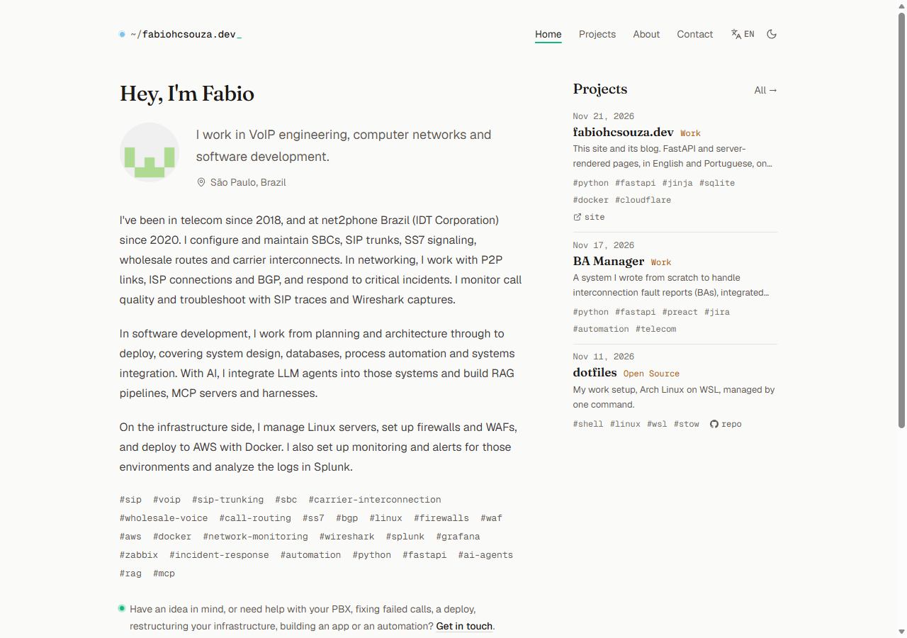
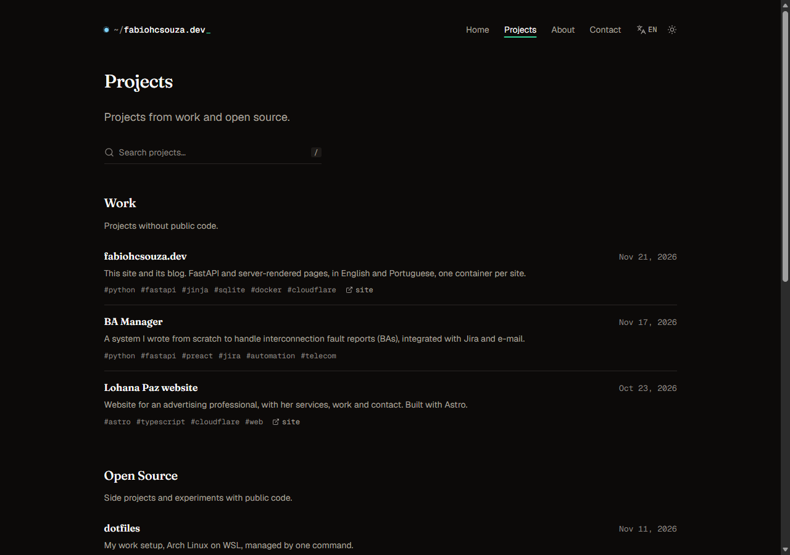
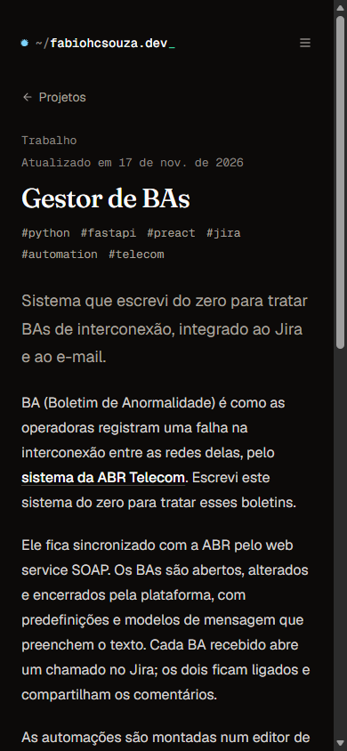

The portfolio you are reading and the blog next to it, in English and Portuguese.

## Architecture

One Python 3.14 codebase with three parts: `core` (what both sites use), `portfolio` and `blog`. It builds one Docker
image, and an environment variable picks the site each container serves; in development one process serves both.
The `Host` header routes each request to its site, and a `/pt` prefix switches the language without duplicating any
route.

FastAPI renders every page on the server with Jinja2. A page is declared once, in one line, and that line creates the
route, the sitemap entry with its hreflang alternates, the menu link and the test that opens it in both languages.
Pages are cached with an ETag, so an unchanged page answers 304.

Posts, works and pages are Markdown folders with a front matter checked by Pydantic at start: a broken file stops the
app with its name in the error. markdown-it-py renders them with raw HTML off, Pygments highlights the code, and
images get their size and a WebP copy. Interface text goes through gettext (Babel), and dates come from CLDR.

The CSS and JavaScript are plain files, with self-hosted fonts and no build step. There is no inline script or style,
so the Content-Security-Policy allows only the site itself.

## Data and e-mail

SQLite in WAL mode through SQLModel, one database file per site. The contact form saves the message and e-mails it
after the response, over SMTP to my own mail server (Stalwart). The newsletter confirms each address by e-mail, signs
its links with HMAC, supports one-click unsubscribe (RFC 8058) and sends each post by hand with a command that resumes
where it stopped. Old data is deleted every day.

## Security

An ASGI middleware checks every request before it reaches a route: known host, CSRF by Origin and Sec-Fetch-Site,
rate limits per IP (in memory and in SQLite), a body size cap, and the security headers, HSTS included. The forms
add a honeypot and Cloudflare Turnstile, which refuses the post when Cloudflare can't be reached. In production the app
refuses to start with an insecure setting.

## Deploy and tests

Docker Compose on a VPS, behind a Cloudflare Tunnel. About 160 pytest tests cover the pages in both languages, the
forms, the newsletter and the security rules, and CI runs them with the linters on every push.

