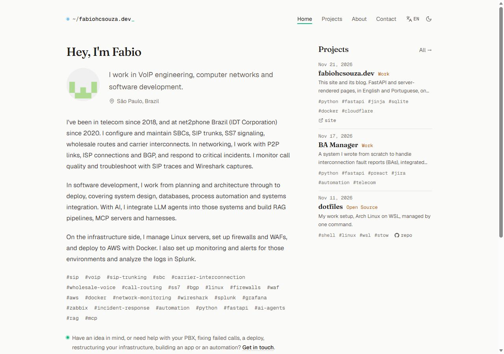
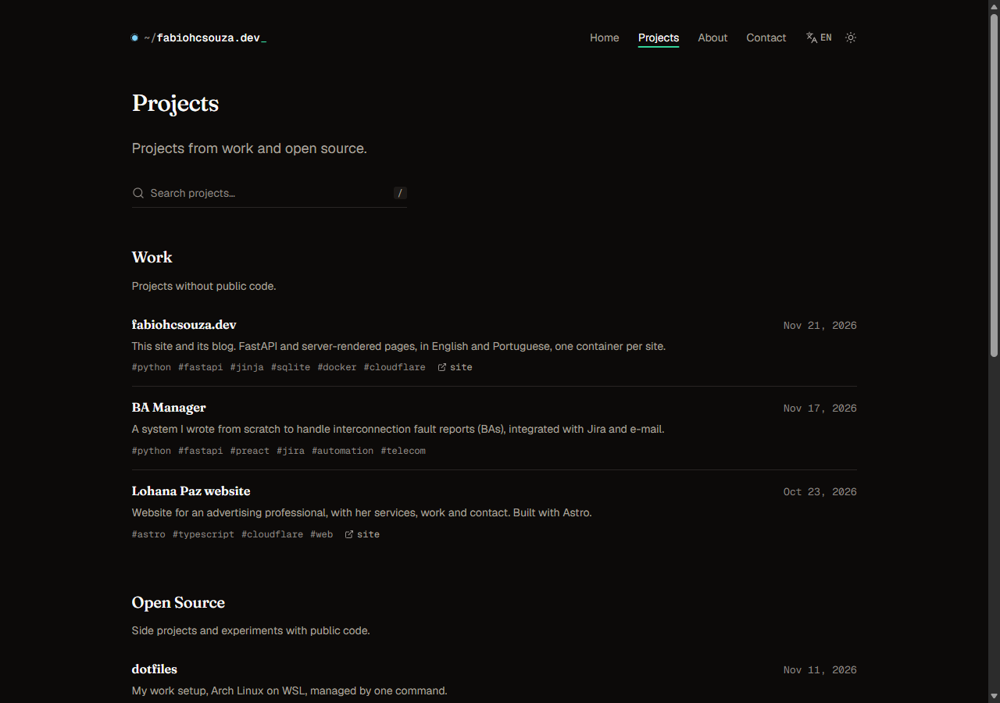
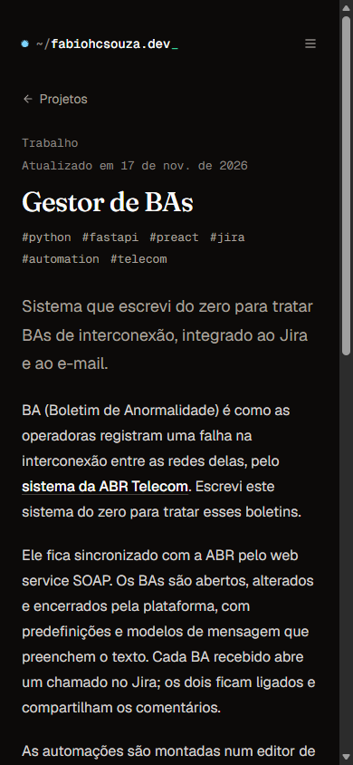

O portfólio que você está lendo e o blog ao lado, em inglês e português.

## Arquitetura

Um código em Python 3.14 com três partes: `core` (o que os dois sites usam), `portfolio` e `blog`. Ele gera uma
imagem Docker, e uma variável de ambiente escolhe o site que cada container serve; em desenvolvimento um processo
serve os dois. O cabeçalho `Host` leva cada requisição ao seu site, e o prefixo `/pt` troca o idioma sem duplicar
nenhuma rota.

O FastAPI gera todas as páginas no servidor com Jinja2. Uma página é declarada uma vez, numa linha, e essa linha cria
a rota, o item do sitemap com os hreflang, o link no menu e o teste que abre a página nos dois idiomas. As páginas usam
ETag, então uma página sem mudança responde 304.

Posts, trabalhos e páginas são pastas de Markdown com um cabeçalho validado pelo Pydantic na subida: um arquivo
quebrado impede o app de subir e o erro diz qual é. O markdown-it-py renderiza com HTML cru desligado, o Pygments
colore o código, e as imagens ganham tamanho e uma cópia em WebP. Os textos da interface passam pelo gettext (Babel),
e as datas vêm do CLDR.

O CSS e o JavaScript são arquivos puros, com fontes hospedadas no próprio site e sem build. Não há script nem estilo
inline, então a Content-Security-Policy só permite o próprio site.

## Dados e e-mail

SQLite em modo WAL pelo SQLModel, um arquivo de banco por site. O formulário de contato grava a mensagem e manda por
e-mail depois da resposta, por SMTP para o meu próprio servidor de e-mail (Stalwart). A newsletter confirma cada
endereço por e-mail, assina os links com HMAC, aceita o cancelamento em um clique (RFC 8058) e envia cada post por um
comando que eu rodo e que continua de onde parou. Os dados antigos são apagados todo dia.

## Segurança

Um middleware ASGI confere cada requisição antes da rota: domínio conhecido, CSRF pela Origin e pelo Sec-Fetch-Site,
limite por IP (em memória e no SQLite), tamanho máximo do corpo e os cabeçalhos de segurança, HSTS incluído. Os
formulários têm honeypot e Cloudflare Turnstile, que recusa o envio quando a Cloudflare não responde. Em produção o app
se recusa a subir com configuração insegura.

## Deploy e testes

Docker Compose num VPS, atrás de um Cloudflare Tunnel. Uns 160 testes com pytest cobrem as páginas nos dois idiomas,
os formulários, a newsletter e as regras de segurança, e o CI roda todos com os linters a cada push.

