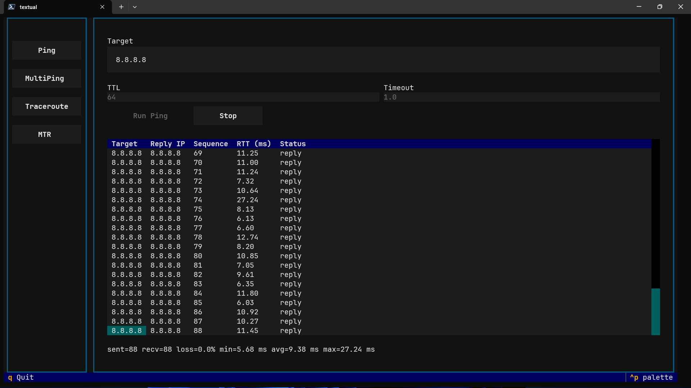
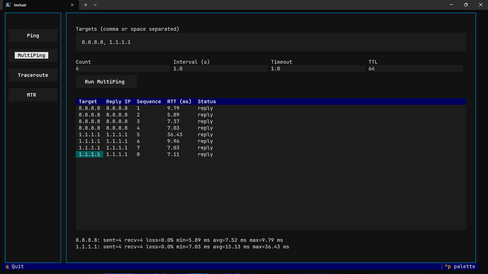
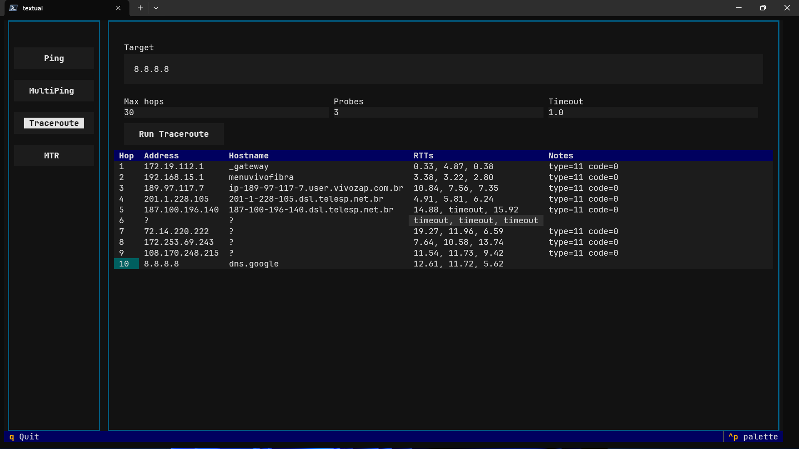
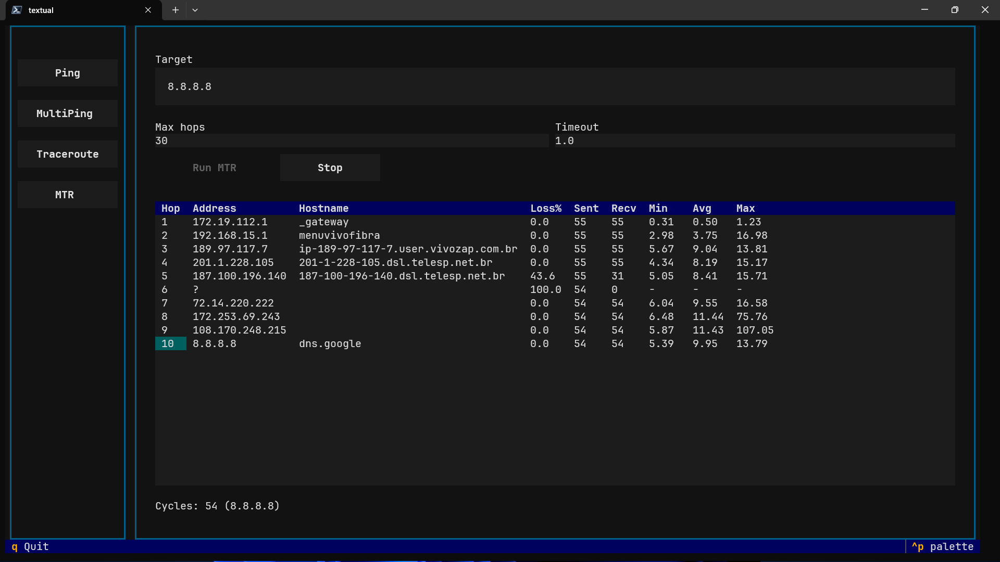

A Python library for ping and traceroute over raw sockets, built from parts instead of wrapping the system tools.

## The library

A `Client` opens and closes the raw socket. `probe()` sends one packet with a given TTL, `ping()` repeats it and
`traceroute()` walks the hops; each returns dataclasses with the times and the replies, ready to print or store.
Reverse DNS is optional per request. When Python lacks `CAP_NET_RAW`, the error says so, and
`uvx icmpx --bootstrap-cap` grants it.

## The terminal UI

`uvx icmpx` opens a Textual app with four views: ping with a live loss and RTT summary, ping to several hosts at once,
traceroute, and an MTR view that keeps refreshing the stats of each hop. The examples folder has the same flows as
short scripts, including an MTR table made with Rich.

