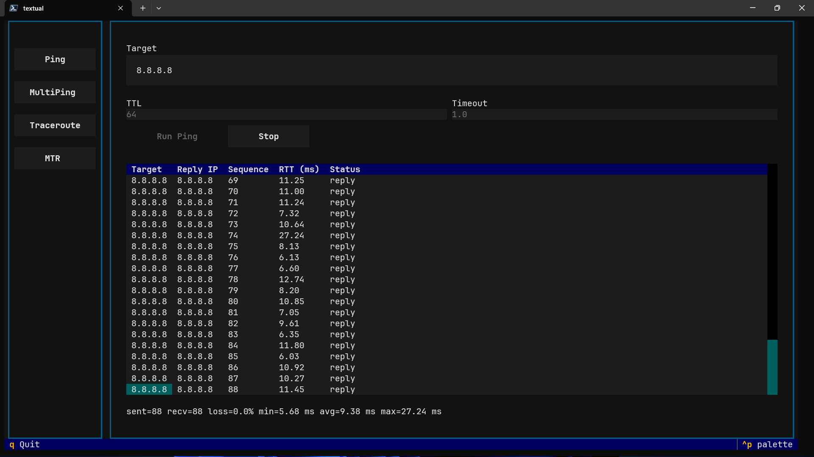
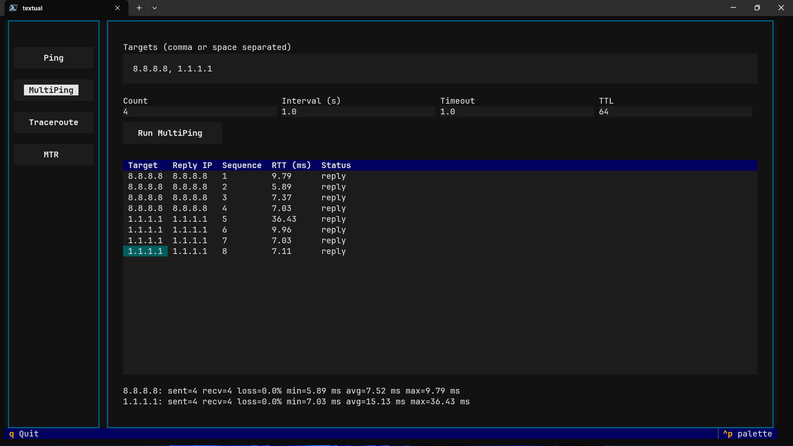
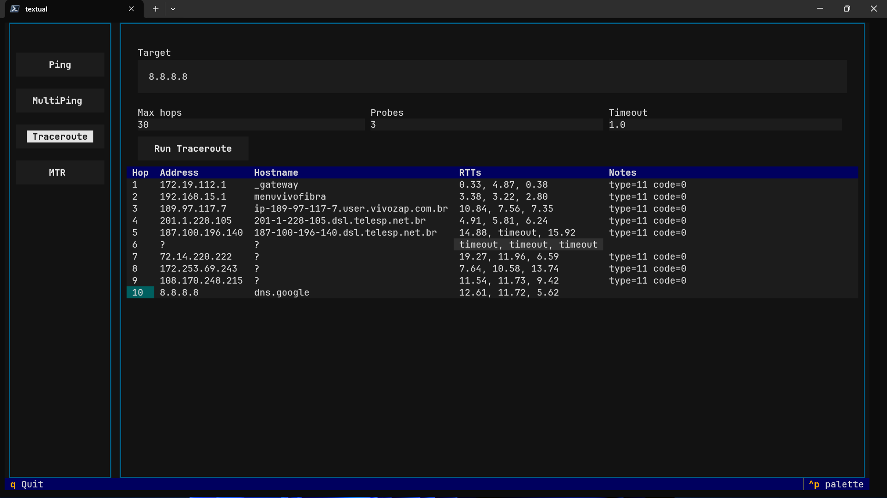
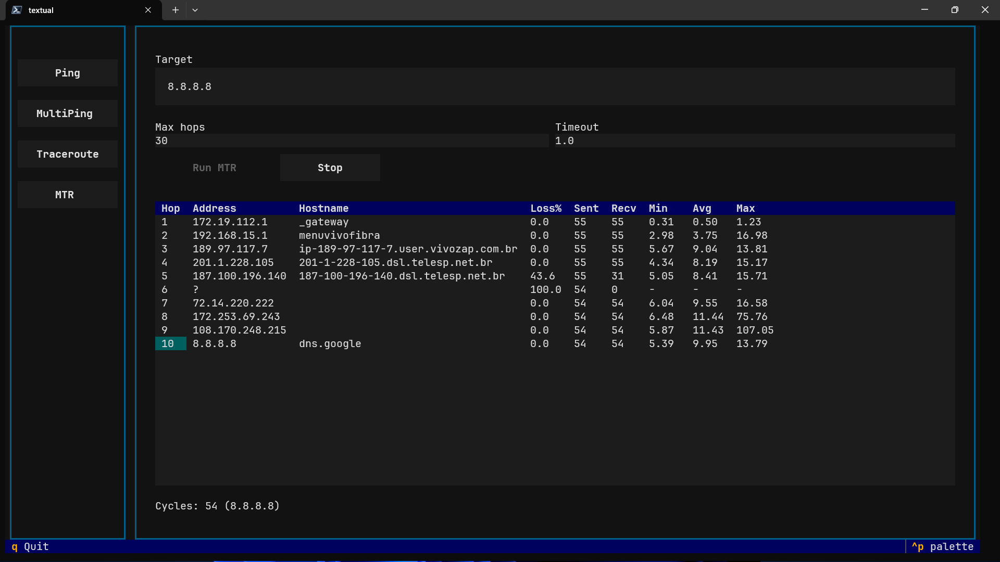

Biblioteca Python para ping e traceroute com raw sockets, montada em partes em vez de chamar as ferramentas do
sistema.

## A biblioteca

Um `Client` abre e fecha o raw socket. `probe()` manda um pacote com um TTL definido, `ping()` repete e `traceroute()`
percorre os saltos; cada um devolve dataclasses com os tempos e as respostas, prontos para imprimir ou guardar. O DNS
reverso é opcional em cada requisição. Quando o Python não tem `CAP_NET_RAW`, o erro avisa, e o
`uvx icmpx --bootstrap-cap` concede a permissão.

## A interface de terminal

O `uvx icmpx` abre um app em Textual com quatro telas: ping com resumo de perda e RTT ao vivo, ping para vários hosts
ao mesmo tempo, traceroute, e uma tela MTR que atualiza as estatísticas de cada salto. A pasta de exemplos tem os
mesmos fluxos em scripts curtos, inclusive uma tabela MTR feita com Rich.

