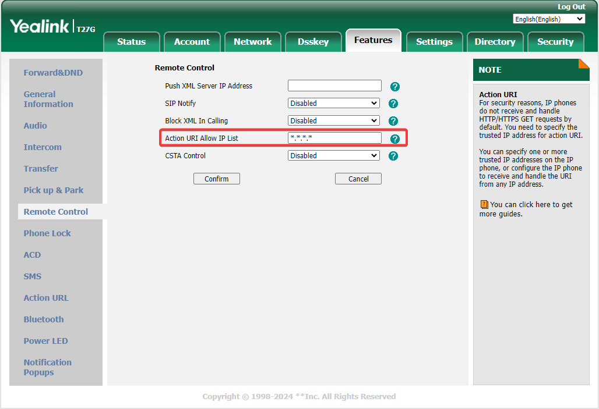
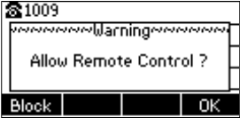

Controls a Yealink desk phone over the network, through its Action URI.

```python
yl = YealinkController("admin", "admin", "192.168.1.10")
yl.set_line(1)
yl.dial("1234")
yl.screenshot()
yl.hangup()
```

A script picks the line, reads the status, dials, hangs up and saves a screenshot of the display. The phone has to
allow Action URI requests from the computer and accept remote control once:




