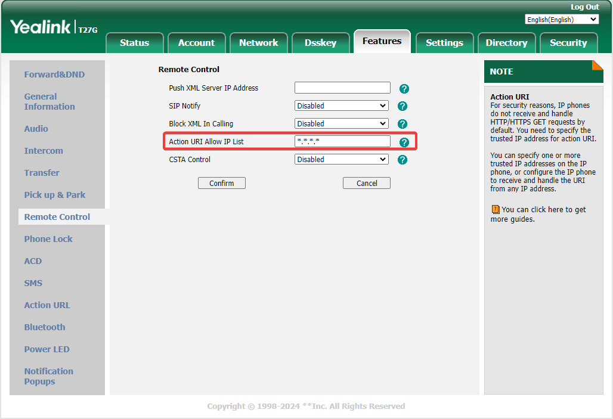
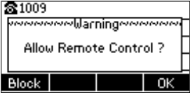

Controla um telefone de mesa Yealink pela rede, pela Action URI.

```python
yl = YealinkController("admin", "admin", "192.168.1.10")
yl.set_line(1)
yl.dial("1234")
yl.screenshot()
yl.hangup()
```

Um script escolhe a linha, lê o status, disca, desliga e salva um print da tela. O telefone precisa aceitar
requisições Action URI do computador e liberar o controle remoto uma vez:




